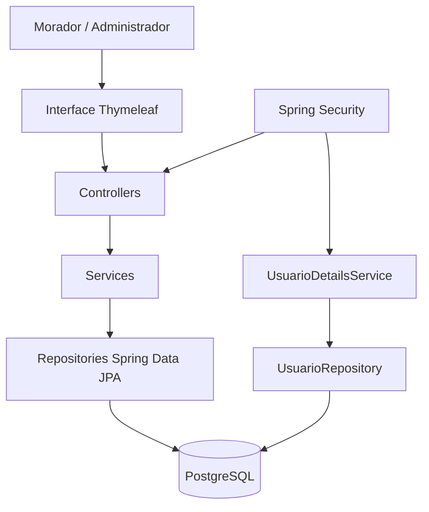
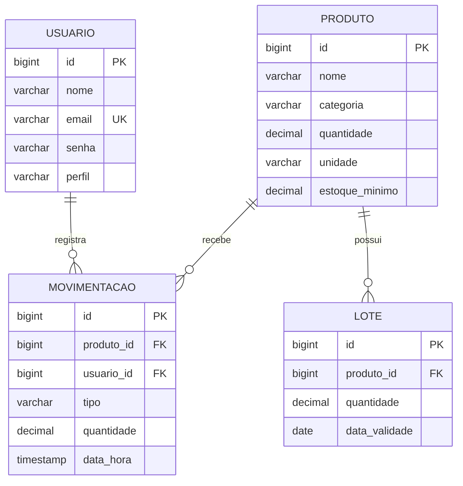

# Documentação técnica — DomusHub

## 1. Visão do produto
O DomusHub é um sistema de gestão inteligente da despensa doméstica. Seu propósito é permitir que moradores registrem produtos, acompanhem quantidades e validades e recebam alertas para reduzir esquecimentos e desperdícios.

## 2. Problema e solução
**Problema:** moradores nem sempre sabem quais produtos possuem, em que quantidade estão disponíveis ou quais estão próximos do vencimento.

**Solução:** centralizar os dados da despensa em uma aplicação com cadastro, movimentações, lotes, alertas e acesso controlado por perfil.

## 3. Escopo da versão entregue
Incluído:
- Autenticação por e-mail e senha.
- Perfis ADMIN e MORADOR.
- CRUD de produtos para ADMIN.
- Consulta de produtos para usuários autenticados.
- Entrada e saída de estoque.
- Registro de lotes e validade.
- Alertas no dashboard.
- Histórico das últimas movimentações.

Fora do escopo desta versão:
- Integração com sensores/geladeira IoT.
- Compra ou reposição automática real.
- Aplicativo mobile nativo.
- Notificações por e-mail ou push.

## 4. Arquitetura de software
A aplicação usa arquitetura em camadas com padrão MVC na camada web.

### Camadas
1. Apresentação: Thymeleaf renderiza páginas HTML.
2. Controle: Controllers recebem requisições e preparam modelos para as páginas.
3. Aplicação/domínio: Services aplicam regras de negócio.
4. Persistência: Repositories usam Spring Data JPA.
5. Banco: PostgreSQL armazena dados relacionais.

### Princípios
- Separação de responsabilidades.
- Baixo acoplamento entre interface e persistência.
- Encapsulamento das entidades.
- Regras de negócio centralizadas em serviços.
- Validação na entrada e na camada de serviço.

## 5. Diagrama de componentes (Mermaid)

## 6. Modelo entidade-relacionamento

## 7. Classes e responsabilidades
| Classe | Responsabilidade |
|---|---|
| `Usuario` | Representa uma pessoa com acesso ao sistema. |
| `Produto` | Representa um item da despensa. |
| `Lote` | Representa uma entrada de produto com validade específica. |
| `Movimentacao` | Registra entrada ou saída de quantidade. |
| `Perfil` | Define ADMIN ou MORADOR. |
| `TipoMovimentacao` | Define ENTRADA ou SAIDA. |
| `ProdutoService` | Centraliza operações e regras de estoque. |
| `UsuarioDetailsService` | Integra usuários do banco ao Spring Security. |

## 8. Segurança e permissões
- Spring Security exige autenticação para as páginas internas.
- BCrypt é usado para armazenar hashes de senha.
- ADMIN pode gerenciar usuários e o cadastro/edição/exclusão de produtos.
- MORADOR pode consultar produtos e registrar movimentações.
- O controle é aplicado no servidor por regras de autorização, não apenas na interface.

## 9. Casos de uso
**Administrador**
- Entrar no sistema.
- Consultar dashboard e despensa.
- Cadastrar, editar e excluir produtos.
- Cadastrar usuários.
- Registrar lotes e movimentações.

**Morador**
- Entrar no sistema.
- Consultar dashboard e despensa.
- Registrar entrada e saída de produtos.
- Consultar alertas e histórico.

## 10. Plano de testes manuais
| ID | Cenário | Resultado esperado |
|---|---|---|
| T01 | Login com senha correta | Acesso ao painel |
| T02 | Login com senha incorreta | Permanecer no login com erro |
| T03 | Morador abre /usuarios | Acesso negado |
| T04 | Morador tenta cadastrar produto | Acesso negado |
| T05 | ADMIN cadastra produto válido | Produto salvo |
| T06 | Quantidade negativa | Validação/erro |
| T07 | Saída maior que o estoque | Operação recusada |
| T08 | Entrada válida | Quantidade incrementada e movimentação salva |
| T09 | Lote com validade futura | Lote salvo |
| T10 | Lote vencendo em até 7 dias | Aparece no dashboard |
| T11 | Estoque igual ou abaixo do mínimo | Aparece alerta de estoque baixo |
| T12 | Reiniciar aplicação | Dados permanecem no PostgreSQL |

## 11. Melhorias recomendadas
1. Adicionar testes unitários para `ProdutoService`.
2. Criar DTOs para separar formulários das entidades JPA.
3. Adicionar tratamento global de exceções.
4. Criar paginação e filtros.
5. Implementar edição de usuários e redefinição de senha.
6. Fazer as quantidades dos lotes refletirem automaticamente as entradas e saídas, com estratégia de consumo por validade (FEFO).
7. Criar auditoria e notificações.
8. Adicionar testes de integração com PostgreSQL.

## 12. Observação acadêmica
O sistema é uma implementação inicial que demonstra orientação a objetos, persistência relacional, autenticação, autorização, validação e arquitetura em camadas. A equipe deve executar, testar, compreender e adaptar o código. Não apresentem como implementado nenhum recurso listado apenas como melhoria futura.
